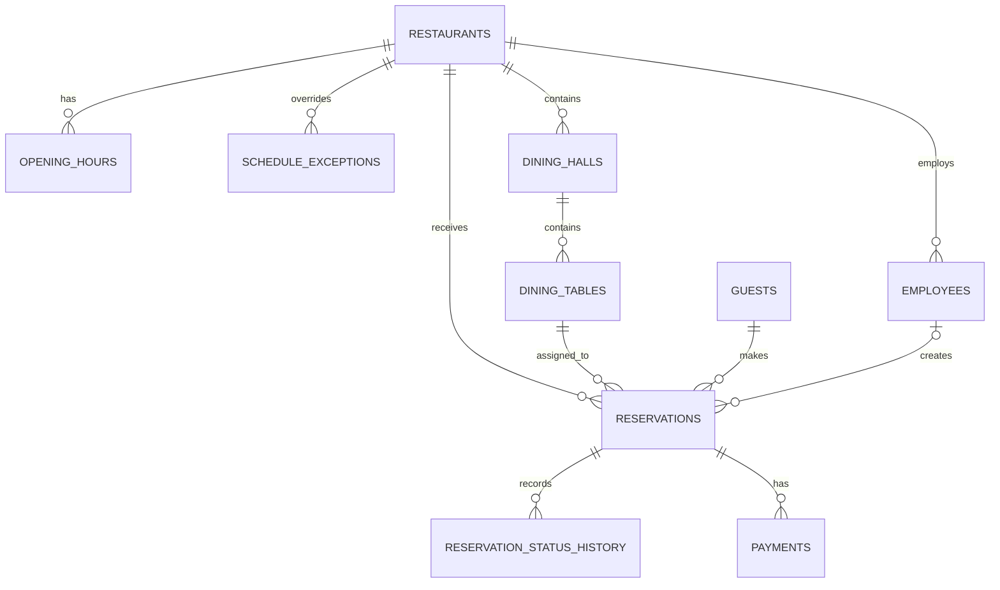

# Restaurant schema

Это физическая модель PostgreSQL, создаваемая файлом [`sql/01_restaurant_schema.sql`](../sql/01_restaurant_schema.sql). Первичные и внешние ключи поддерживают ссылочную целостность. `CHECK`-ограничения и триггер проверяют бизнес-правила, а GiST exclusion constraint не позволяет сохранить пересекающиеся активные бронирования одного стола.
