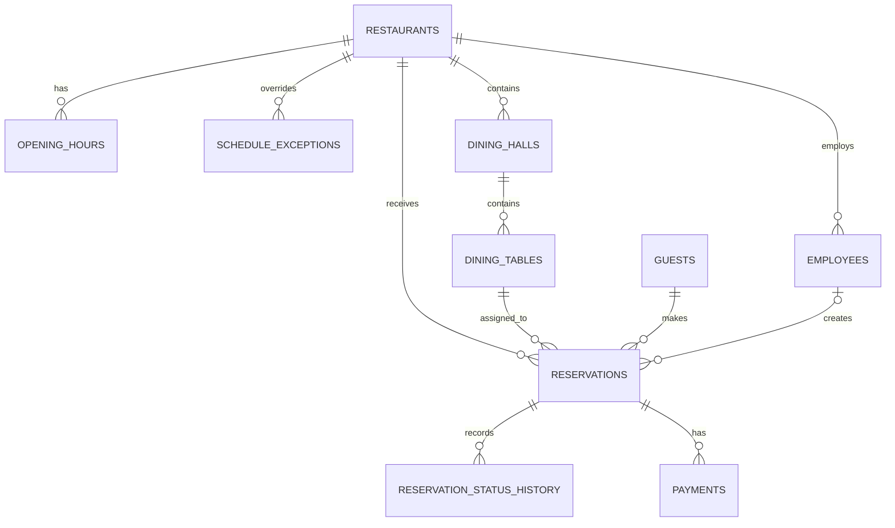

# Restaurant schema

This physical PostgreSQL model is created by [`sql/01_restaurant_schema.sql`](../sql/01_restaurant_schema.sql). Primary and foreign keys maintain referential integrity. `CHECK` constraints and a validation trigger enforce business rules. A GiST exclusion constraint prevents overlapping active reservations for the same table.
